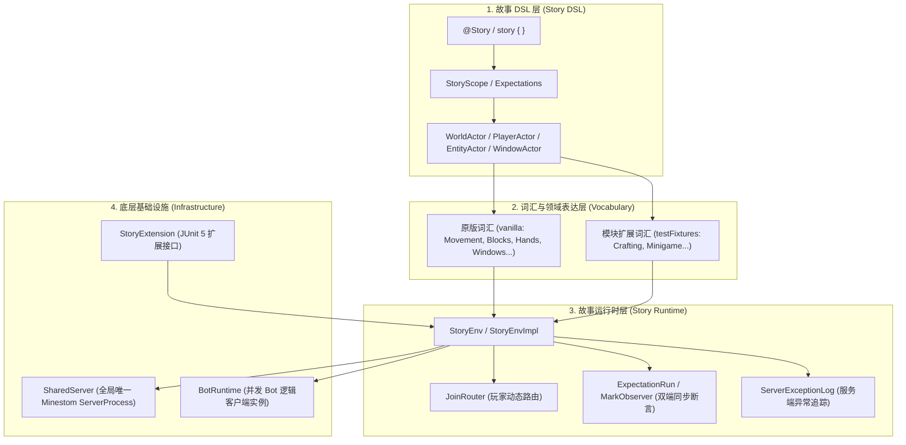
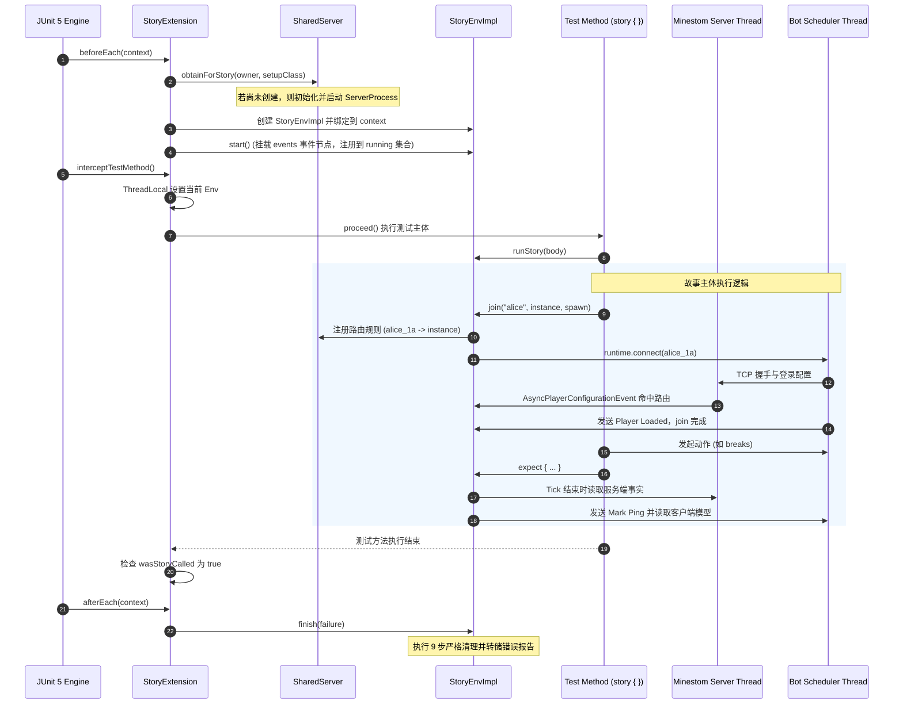

# 架构参考

[目录](README.md) · 上一篇：[快速上手](getting-started.md) · 下一篇：[同步机制与 Tick 检查](synchronization-and-ticks.md)

本篇目录：

- [总体分层架构](#总体分层架构)
- [核心组件与职责](#核心组件与职责)
- [测试生命周期与执行链路](#测试生命周期与执行链路)
- [共享服务端模型（SharedServer）](#共享服务端模型sharedserver)
- [测试类型划分：General 与 Isolated](#测试类型划分general-与-isolated)
- [多模块集成与跨模块依赖](#多模块集成与跨模块依赖)

---

## 总体分层架构

`story` 框架自顶向下分为四个核心层次：



1. **故事 DSL 层**：对外暴露干净、无侵入的叙事 DSL，定义角色、场景、时间推进与结果断言。
2. **词汇层**：封装底层复杂交互逻辑（例如视距检查、手部发包、容器槽位计算），将其转换为拟人化的动作谓词与事实描述。
3. **故事运行时层**：管理每个具体故事的上下文环境，负责多测试并发下的路由分配、Tick 监听、标记同步与状态转储。
4. **基础设施层**：管理真实的 Minestom 服务端网络进程、BotRuntime 线程池以及与 JUnit 5 执行框架的对接。

---

## 核心组件与职责

### 1. `StoryExtension`
- 实现 JUnit 5 的 `BeforeEachCallback`, `AfterEachCallback`, `InvocationInterceptor`。
- 在测试方法执行前定位归属服务端并初始化 `StoryEnvImpl`。
- 绑定当前测试线程的 `ThreadLocal`，确保 `story { ... }` 能够透明解析到正确的运行时。
- 在测试结束后触发完整的 9 步故障安全清理流程。

### 2. `SharedServer`
- 单例守护对象，管理当前 JVM 内部唯一的 Minestom 服务端实例。
- 维护全局唯一的 `ServerOwner`（标识该服务端是属于通用模块还是属于某个 `@IsolatedJvm` 类）。
- 启动 Minestom 进程并在回环地址（Loopback）绑定实际监听端口。
- 在 `ServerTickMonitorEvent` 上挂载全局 Tick 结束钩子（`TickEnd`），驱动所有故事的 Tick 检查与暂停点。

### 3. `StoryEnvImpl`
- 代表一个具体 `@Story` 测试的隔离运行时环境。
- 持有该故事专属的世界集合（`instances`）与玩家集合（`players`）。
- 拥有独立的事件节点（`events: EventNode<Event>`），自动过滤非本故事世界和玩家的事件。
- 为该故事按需创建并管理专属的 `BotRuntime` 调度实例。

### 4. `JoinRouter`
- 解决共享服务端下多故事玩家接入的碰撞问题。
- 将 Minestom 的全局 `AsyncPlayerConfigurationEvent` 拦截优先级设为 `Int.MAX_VALUE`。
- 依据玩家连接时传入的唯一用户名（`name_<suffix>`），动态将玩家导流至该故事指定的世界（`Instance`）与出生坐标（`Pos`）。

### 5. `Marks` 与 `MarkObserver`
- 利用原版协议特性，向指定玩家下发带递减负数 ID 的 `ClientboundPingPacket` 标记。
- 当客户端 Bot 在其内部调度线程处理完该标记时，触发对应的回调。这一机制保证了「服务端直到此 Tick 发出的所有数据包均已被客户端完全解析并更新进客户端状态模型」。

---

## 测试生命周期与执行链路

单个 `@Story` 测试方法的完整生命周期执行顺序如下：



---

## 共享服务端模型（SharedServer）

传统测试方案（如 `net.minestom:testing`）通常在每个测试用例中调用 `MinecraftServer.updateProcess()` 重置进程。但在真实 Minecraft 架构中，该做法会导致一系列底层隐患：
- Minestom 内部存在大量单例静态字段与缓存（例如 `ChatMessageListener`、物品原型绑定到 JVM 首个创建的注册表等），频繁启停服务端会导致静态污染。
- 频繁启停无法支撑多测试用例的高效并行。

`story` 采用了**单进程共享服务端**架构：
1. **真实网络栈推进**：服务端进程在后台以每秒 20 Tick（标准游戏时钟）真实运行，通过真实的 TCP Loopback 端口对外暴露。
2. **禁止测试内模拟模式**：框架明确要求 `ServerProperties.INSIDE_TEST.get() == false`。`minestom.inside-test` 会关闭动态注册表的冻结并篡改玩家出生逻辑，导致测试环境与生产运行行为出现偏差。
3. **命名空间与环境隔离**：
   - 每个故事创建专属的 `InstanceContainer`，测试结束时从服务端注销。
   - 玩家角色分配带唯一递增后缀的用户名（如 `alice_1a`）。
   - 事件监听器挂载在带谓词过滤的专属子 `EventNode` 上，互不串扰。

---

## 测试类型划分：General 与 Isolated

| 维度 | 常规测试（General） | 隔离测试（Isolated） |
|---|---|---|
| **注解声明** | 仅标注 `@Story` | 顶层测试类标注 `@IsolatedJvm(setup = ...)` |
| **执行 JVM** | 模块内的全部用例共享同一个 JVM 进程 | 每个测试类独占一个全新的独立 JVM 进程 |
| **Gradle 任务** | `./gradlew test` | `./gradlew isolatedTest` |
| **服务端准备** | 统一由模块的 `yuanban.story.setup` 初始化 | 由类注解指定的专属 `ServerSetup` 初始化 |
| **属性可变性** | 服务端属性只读（不可修改 `ServerProperties`） | 允许在 `beforeInit()` 中修改服务端属性 |
| **并发执行** | 支持不同故事之间并发多线程执行 | 单个类内部多故事并发，但 JVM 进程隔离 |
| **典型应用场景** | 绝大多数玩法机制、配方合成、方块逻辑、实体交互 | 涉及全局静态标签替换、注册表重载、修改视距等破坏性配置 |

> [!IMPORTANT]
> `@IsolatedJvm` **只能标注在顶层类上**。若标注在 `@Nested` 内部类上，测试启动时会抛出 `ExtensionConfigurationException`，因为 JUnit 会在同一个 JVM 中并发执行外层与嵌套类，无法实现进程独占。

---

## 多模块集成与跨模块依赖

当其他业务模块需要使用或贡献测试词汇时，遵循以下工程约定：

1. **词汇提供方**：
   - 在其 `build.gradle` 中启用 `java-test-fixtures` 插件：
     ```groovy
     plugins {
         id("java-test-fixtures")
     }
     dependencies {
         testFixturesApi(project(":story"))
     }
     ```
   - 将专用业务词汇写在 `src/testFixtures/kotlin` 目录下。

2. **词汇使用方**：
   - 依赖提供方的 testFixtures：
     ```groovy
     dependencies {
         testImplementation(project(":story"))
         testImplementation(testFixtures(project(":crafting")))
     }
     ```

[目录](README.md) · 上一篇：[快速上手](getting-started.md) · 下一篇：[同步机制与 Tick 检查](synchronization-and-ticks.md)
