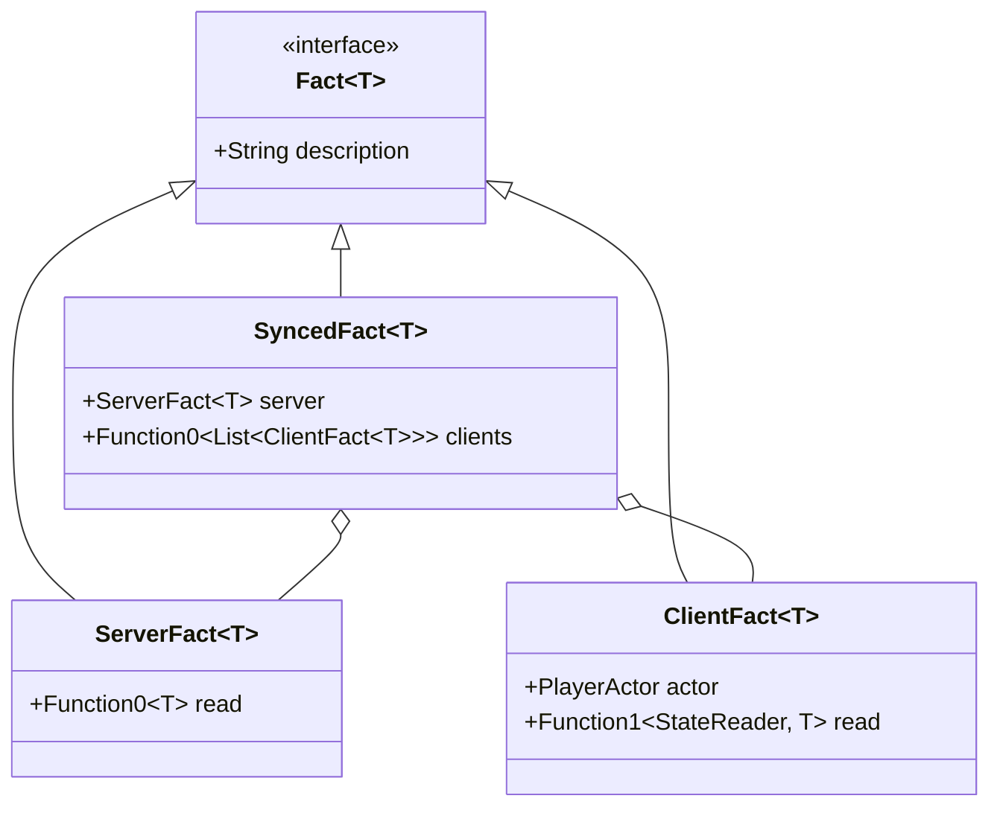

# 事实与期望

[目录](README.md) · 上一篇：[同步机制与 Tick 检查](synchronization-and-ticks.md) · 下一篇：[角色与世界](actors-and-world.md)

本篇目录：

- [什么是事实（Fact）](#什么是事实fact)
- [三类事实：服务端、客户端与同步事实](#三类事实服务端客户端与同步事实)
- [事实衍生与映射（`map`）](#事实衍生与映射map)
- [期望 DSL（Expectations）](#期望-dslexpectations)
- [复合期望与时限模式（`expect`）](#复合期望与时限模式expect)
- [Kotest Matcher 集成与自定义匹配](#kotest-matcher-集成与自定义匹配)
- [断言结果报告与核验现场转储](#断言结果报告与核验现场转储)

---

## 什么是事实（Fact）

在 `story` 中，被断言的目标不是普通的内存变量，而是实现了 `Fact<T>` 的领域事实对象：

```kotlin
sealed interface Fact<T> {
    /** 事实的自然语言描述，例如「alice 的生命值」、「world (0, 64, 0) 处的方块」 */
    val description: String
}
```

### 事实的特点

1. **惰性求值**：事实对象本身不保存固定数值，而是一个读取器。只有在断言引擎触发 Tick 核验时，才会在正确的线程（服务端调度线程或 Bot 调度线程）上提取该时刻的瞬时值。
2. **防误用保护**：如果在 `story { }` 作用域之外直接对 `Fact` 调用 Kotest 的普通 `shouldBe`，Kotest 比较的是 `Fact` 实例本身。`Fact.toString()` 会明确输出：
   `事实：<description>（只能在 story { } 与 expect { } 中检查）`，从而及时提示开发者语法错误。

---

## 三类事实：服务端、客户端与同步事实



### 1. 服务端事实（`ServerFact<T>`）
- **核验时机**：在每个 Tick 结束时（`ServerTickMonitorEvent`），于 Minestom 的 **Tick 调度线程**上直接读取。
- **典型场景**：仅服务端可见或服务端权威的状态。
- **示例**：
  - `world.time`（世界游戏时间）
  - `entity.position` / `entity.alive` / `entity.onFire`（实体服务端状态）
  - `alice.online`（玩家在服务端的在线标记）

### 2. 客户端事实（`ClientFact<T>`）
- **核验时机**：当标记 Ping 抵达客户端时，在 **Bot 调度线程**上以该时刻的 `StateReader` 模型快照读取。
- **典型场景**：仅客户端感知到的界面表现、HUD、聊天日志等。
- **示例**：
  - `alice.client.window`（客户端打开的 GUI 窗口快照）
  - `alice.client.actionBar` / `alice.client.title`（动作栏与大标题文本）
  - `alice.messages` / `alice.messagesFrom(bob)`（接收到的聊天记录）

### 3. 同步事实（`SyncedFact<T>`）
- **核验时机**：**同时核验双端**。在 Tick 结束时读取服务端值，并在标记到达后分别读取每一个相关客户端的值。只有双端全部满足 Matcher 时，该项事实才算成立。
- **典型场景**：所有由服务端权威控制并向客户端广播的核心玩法状态。
- **示例**：
  - `spot.block`：服务端方块，以及该世界内加载了该区块的所有玩家客户端看到的方块。
  - `alice.position`：服务端玩家坐标，以及 alice 本地客户端的坐标。
  - `alice.health` / `alice.food` / `alice.gameMode`：双端生命值、饥饿度、游戏模式。
  - `alice.inventory` / `alice.hand`：双端物品栏内容与主手物品。
  - `alice.alive`：双端存活状态。

---

## 事实衍生与映射（`map`）

可以基于已有事实通过 `.map(...)` 派生出新的衍生事实，底层会自动保持双端同步读取语义：

```kotlin
// 从 alice.hand (SyncedFact<ItemCount?>) 衍生出数量事实
val handCount: Fact<Int> = alice.hand.map("alice 主手物品数量") { it?.count ?: 0 }

handCount shouldBe 5
```

---

## 期望 DSL（Expectations）

在 `story { ... }` 或 `expect { ... }` 代码块内，`Expectations` 接口提供了丰富的中缀断言操作符：

| 断言操作 | 说明 | 示例 |
|---|---|---|
| `fact should matcher` | 使用任意 Kotest 的 `Matcher<T>` 进行匹配 | `alice.health should beGreaterThan(10f)` |
| `fact shouldBe value` | 精确值相等匹配 | `alice.food shouldBe 20` |
| `fact shouldNotBe value` | 不等匹配 | `alice.hand shouldNotBe null` |
| `blockFact shouldBe block` | 比较方块**类型**（忽略属性），使用 `Block.compare` | `spot.block shouldBe Block.STONE` |
| `blockFact shouldBeExactly block` | 比较方块**完整状态**（包括方向、开闭等所有属性） | `door.block shouldBeExactly Block.OAK_DOOR.withProperty("open", "true")` |
| `invFact shouldContain material` | 物品栏中该物品总数至少为 1 | `alice.inventory shouldContain Material.IRON_INGOT` |
| `invFact shouldContain itemCount` | 物品栏中该物品总数之和至少为 `count` | `alice.inventory shouldContain (Material.STICK * 4)` |
| `invFact shouldNotContain material` | 物品栏中不包含该物品 | `alice.inventory shouldNotContain Material.DIRT` |
| `posFact shouldBeAt spot` | 坐标点落在指定的整方块格中（`blockX/Y/Z` 一致） | `alice.position shouldBeAt spawn.north(2)` |

---

## 复合期望与时限模式（`expect`）

单项断言默认在 `defaults.timeout`（默认 10 秒）内等待其成立。若需要多个条件**原子性同时满足**，使用 `expect` 块。

### 1. `Within` 模式（超时前某 Tick 成立即可）

```kotlin
// 故事时钟经过 5 秒之内，某一个 tick 检查中两项同时成立
expect(within = 5.seconds) {
    alice.position shouldBeAt targetSpot
    alice.hand shouldBe Material.DIAMOND_SWORD * 1
}

// 接下来 10 个 tick 检查内成立（适合严格限制反应速度）
expect(within = 10) {
    target.block shouldBe Block.AIR
}
```

### 2. `Throughout` 模式（在指定区间内必须一直成立）

用于测试不变性约束（例如玩家处于无敌状态、方块未被篡改等）：

```kotlin
// 接下来连续 40 个 tick 内生命值必须一直为 20（中途任何一个 tick 掉血立即失败）
expectThroughout(ticks = 40) {
    alice.health shouldBe 20.0f
}

// 故事时钟接下来的 2 秒内一直成立
expectThroughout(duration = 2.seconds) {
    alice.alive shouldBe true
}
```

---

## Kotest Matcher 集成与自定义匹配

所有的期望底层完全基于 Kotest 体系，可无缝组合使用标准 Matcher：

```kotlin
import io.kotest.matchers.floats.beGreaterThan
import io.kotest.matchers.string.shouldContain
import io.kotest.matchers.Matcher
import io.kotest.matchers.MatcherResult

story {
    val alice = player("alice")
    
    // 组合标准 Kotest Matcher
    alice.health should beGreaterThan(5.0f)

    // 自定义 Matcher
    val northFacing = Matcher<Pos> { pos ->
        val yaw = pos.yaw()
        MatcherResult(
            yaw in 170f..190f || yaw in -190f..-170f,
            { "朝向应接近正北 (180°)，实际为 $yaw" },
            { "朝向不应接近正北" }
        )
    }
    alice.position should northFacing
}
```

---

## 断言结果报告与核验现场转储

当断言失败时，控制台与测试日志会清晰打印出最后一次核验（Tick N）的双端实际采样：

```text
✘ 期望（10 秒之内）
  ✘ world (0, 64, -2) 处的方块应为 gold_block；最后一次检查（tick 421）：服务端 air，alice air
      方块应为 gold_block，实际为 air
```

对于同步事实，若存在某一侧不一致（例如服务端已生效但网络丢包/未发包到客户端）：

```text
✘ 期望（5 个 tick 检查之内）
  ✘ world (0, 64, -2) 处的方块应为 air；最后一次检查（tick 55）：服务端 air，alice stone，bob air
      alice：方块应为 air，实际为 stone
```
开发者能一眼看出：**服务端数据已正确，但 alice 的客户端看到的仍是 stone**，瞬间定位出网络同步协议层的问题。

[目录](README.md) · 上一篇：[同步机制与 Tick 检查](synchronization-and-ticks.md) · 下一篇：[角色与世界](actors-and-world.md)
