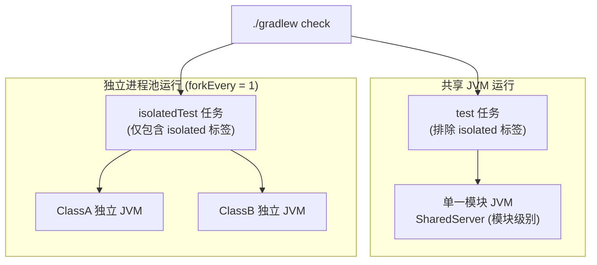

# 隔离测试与服务端准备

[目录](README.md) · 上一篇：[线程模型与运行时](threading-and-runtime.md)

本篇目录：

- [服务端准备接口（ServerSetup）](#服务端准备接口serversetup)
- [故事默认设置（StoryDefaults）](#故事默认设置storydefaults)
- [模块级配置（junit-platform.properties）](#模块级配置junit-platformproperties)
- [隔离测试机制（@IsolatedJvm）](#隔离测试机制isolatedjvm)
- [什么时候应当使用隔离测试](#什么时候应当使用隔离测试)
- [Gradle 构建任务与运行方式](#gradle-构建任务与运行方式)

---

## 服务端准备接口（ServerSetup）

当测试需要全局预载数据包、注册特定配方、修改默认视距或注入自定义方块处理器时，可以通过实现 `ServerSetup<T>` 介入服务端的启动流程：

```kotlin
interface ServerSetup<T> {
    /** 
     * 在 MinecraftServer.init() 之前调用。
     * 仅在 isolatedTest 任务启动的独立 JVM 中可用，用于调用 ServerProperties 中属性的 set 方法。
     */
    fun beforeInit() {}

    /** 
     * 在 MinecraftServer.init() 之后、服务端开始监听与 tick 之前调用一次。
     * 在创建服务端的测试线程上执行。
     * 返回值 T 将通过 setup<T>() 暴露给故事与词汇使用。
     */
    fun configure(process: ServerProcess, defaults: StoryDefaults): T
}
```

### 1. `beforeInit()` 的职责
- 在离线认证及基础注册表初始化前执行。
- 允许修改 Minestom 的全局系统属性（例如 `ServerProperties.CHUNK_VIEW_DISTANCE.set(3)`）。
- 注意：在非隔离的共享 JVM 下，`ServerProperties` 是只读锁定的，尝试写入会直接抛出 `IllegalStateException`。

### 2. `configure(...)` 的职责
- 注册动态注册表条目（Minestom 服务端在启动后会自动冻结注册表，此阶段是最后允许注册的时机）。
- 加载原版或自定义 Datapack 数据包。
- 通过 `process.block().registerHandler(...)` 注册自定义方块逻辑处理器。
- 注册全局测试指令或自定义 `PlayerProvider`。
- 定制故事默认设置 `defaults`。

### 3. 返回值注入（`setup<T>()`）
`configure` 的返回值可以作为模块全局上下文导出：

```kotlin
object MyGameSetup : ServerSetup<GameContext> {
    override fun configure(process: ServerProcess, defaults: StoryDefaults): GameContext {
        val registry = loadCustomRegistry(process)
        return GameContext(registry)
    }
}
```
在任何故事或自定义词汇中均可安全读取：
```kotlin
story {
    val ctx = setup<GameContext>()
}
```

---

## 故事默认设置（StoryDefaults）

`StoryDefaults` 定义了模块内所有故事的通用默认行为：

```kotlin
class StoryDefaults {
    /** 动作与 expect 的默认时限（默认 10 秒）。等待 bot 的动作与 observer 时由 bot 计算，其余等待按照故事时钟计算 */
    var timeout: Duration = 10.seconds

    /** 在故事的 world { } 之前预先应用于每个世界 */
    var world: WorldSpec.() -> Unit = {}

    /** 在 player(name) { } 之前预先应用于每个玩家 */
    var player: PlayerSetup.() -> Unit = {}

    /** summon 创建实体的方式（默认使用 EntityCreature(it)） */
    var entityFactory: (EntityType) -> Entity = { EntityCreature(it) }
}
```

### 冻结保护机制

`StoryDefaults` **只能在 `ServerSetup.configure` 期间修改**。
一旦服务端完成启动，`StoryDefaults` 即被框架永久冻结。在故事执行期间尝试通过 `defaults.timeout = ...` 修改默认值会立即抛出 `IllegalStateException`，保证多用例并发下的配置幂等与线程安全。

---

## 模块级配置（junit-platform.properties）

对于普通的共享测试（General Tests），每个模块可以通过配置参数声明其默认使用的 `ServerSetup`。在模块的 `src/test/resources/junit-platform.properties` 中加入：

```properties
yuanban.story.setup=io.ib67.yuanban.crafting.story.CraftingSetup
```

JUnit 启动时，框架会反射实例化该类（若是 Kotlin `object` 则直接读取单例），并用它完成该模块共享服务端的初始化。

---

## 隔离测试机制（@IsolatedJvm）

当某些测试需要完全排他的测试环境时，使用 `@IsolatedJvm` 注解标记在顶层测试类上：

```kotlin
package io.ib67.yuanban.example

import io.ib67.yuanban.story.IsolatedJvm
import io.ib67.yuanban.story.Story
import io.ib67.yuanban.story.story

// 指定该测试类专用的 Setup，若不指定则回退读取模块的 yuanban.story.setup
@IsolatedJvm(setup = CustomIsolatedSetup::class)
class SpecialSystemStories {

    @Story
    fun `测试在特定服务端属性下的特殊行为`() = story {
        // ...
    }
}
```

### 规则与限制

1. **必须标注在顶层类上**：
   禁止标注在 `@Nested` 内部类上。JUnit 运行外层类时会并发调度内部嵌套类，嵌套类无法独占 JVM，违反隔离约定。
2. **归属检查（ServerOwner Guard）**：
   框架内部记录了服务端的归属（`ServerOwner.Isolated(Class)`）。若在普通 JVM 中误运行了 `@IsolatedJvm` 类，或者在同一个 JVM 中混合了不同归属的用例，`StoryExtension` 会立即中止并报错：
   `这个 JVM 中的服务端属于模块，故事要求的服务端属于 isolated 类 xxx：isolated 类需要单独的 JVM`。

---

## 什么时候应当使用隔离测试

并非所有测试都需要隔离。大部分业务逻辑测试应尽量使用默认的共享服务端模式，以换取极高的执行速度和并发能力。

仅在以下情形**必须**使用 `@IsolatedJvm`：

1. **修改了全局只读服务端属性**：
   例如需要修改视距（`CHUNK_VIEW_DISTANCE`）或网络压缩阈值，这些配置需要通过 `beforeInit()` 修改底层静态字段。
2. **动态重载/篡改全局静态数据**：
   例如 `item-tag` 模块需要替换全局 `Material` 的静态标签表，此类破坏性修改会污染其他测试。
3. **断言面向全体玩家的广播行为**：
   例如测试「当触发全服公告时，所有在线玩家均收到消息」。在共享模式下并发故事的 Bot 也在同一个服务器中，会干扰该断言的纯洁性。

---

## Gradle 构建任务与运行方式

根目录的 `build.gradle.kts` 已原生对测试任务进行了标签路由与进程分流：



### 1. 常规测试任务：`test`
- 自动排除带有 `isolated` 标签的类（`excludeTags("isolated")`）。
- 模块内所有常规 `@Story` 在单一共享 JVM 内以最大并发度跑完。

### 2. 隔离测试任务：`isolatedTest`
- 专门执行带有 `isolated` 标签的类（`includeTags("isolated")`）。
- 关键参数：
  - `forkEvery = 1`：确保每个测试类运行完毕后立即销毁 JVM。
  - `systemProperty("minestom.properties.mutable", "true")`：允许在独立 JVM 中改写 Minestom 全局属性。

### 常用命令

```bash
# 运行全部常规故事测试
./gradlew test

# 运行全部隔离故事测试
./gradlew isolatedTest

# 单独调试运行某个隔离故事测试类
./gradlew :story:isolatedTest --tests "io.ib67.yuanban.story.IsolatedSetupStories"
```

[目录](README.md) · 上一篇：[线程模型与运行时](threading-and-runtime.md)
