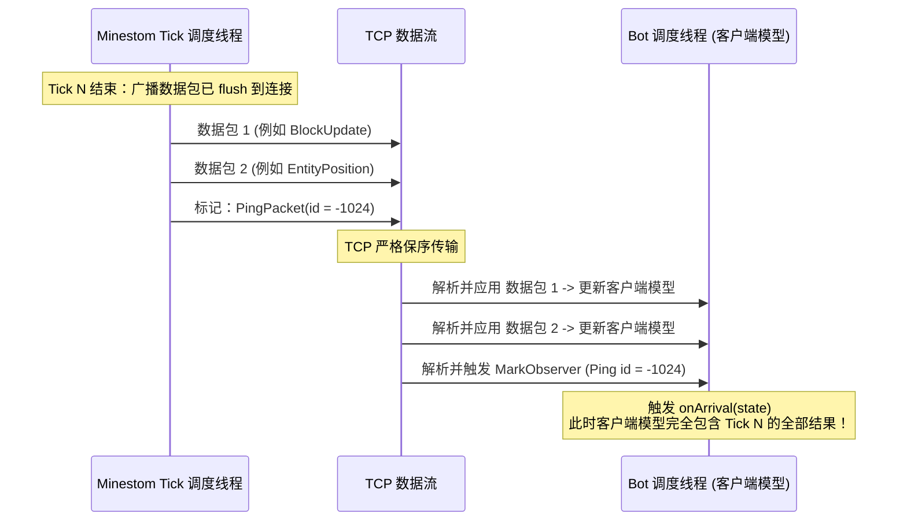
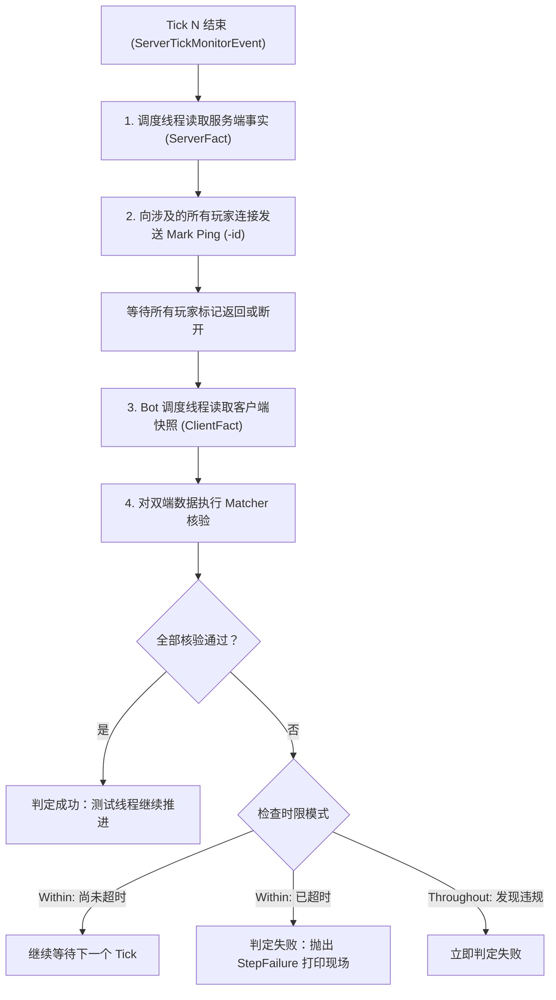

# 同步机制与 Tick 检查

[目录](README.md) · 上一篇：[架构参考](architecture.md) · 下一篇：[事实与期望](facts-and-expectations.md)

本篇目录：

- [测试中的分布式同步难题](#测试中的分布式同步难题)
- [Minestom Tick 生命周期与末尾钩子](#minestom-tick-生命周期与末尾钩子)
- [标记机制（The Mark Protocol）](#标记机制the-mark-protocol)
- [强同步点：`barrier`](#强同步点barrier)
- [确定性断言运行器（ExpectationRun）](#确定性断言运行器expectationrun)
- [故事时钟（StoryClock）与时间语义](#故事时钟storyclock与时间语义)

---

## 测试中的分布式同步难题

在 Minecraft 架构中，服务端与客户端运行在完全独立的线程（甚至是不同物理机）上，两者通过异步网络数据包交互：
1. **网络与调度延迟**：服务端在某一刻修改了方块或生成了实体，数据包仍在 TCP 缓冲区中排队，客户端尚未读取。
2. **批处理广播延迟**：Minestom 等现代服务端往往在 Tick 结尾统一打包广播（Flush），如果在 Tick 中间读取客户端状态，客户端尚未收到本 Tick 的任何变更。
3. **Flaky Tests 的根源**：传统集成测试大多依靠盲目 `Thread.sleep(100)` 尝试等待客户端同步，这在 CI 环境或高负载并发下极易发生偶发性断言失败。

`story` 彻底摒弃了盲目等待与高频盲轮询，通过**标记机制（Mark）**与 **Tick 检查引擎（ExpectationRun）**构建了严格确定性的双端同步模型。

---

## Minestom Tick 生命周期与末尾钩子

Minestom 的标准 Tick 执行链（`ServerProcessImpl.TickerImpl.tick`）顺序如下：

```
1. 调度器在 Tick 开始时的任务 (ExecutionType.TICK_START)
2. 连接层 Tick (ConnectionManager.tick)
3. 实例与实体分发线程并行 Tick (Instance/Entity tick)
4. 调度器在 Tick 结束时的任务 (ExecutionType.TICK_END)
5. 统一刷新广播数据包 (PacketViewableUtils.flush())
6. 触发 ServerTickMonitorEvent
```

`SharedServer` 在全局事件总线上监听 **`ServerTickMonitorEvent`**：
- 该监听器是整个 Tick 中**最后执行的代码**。
- 此时该 Tick 内产生的所有方块变化、实体更新与聊天广播已经全部交给底层连接的 Socket。
- 服务端在该 Tick 的内部状态已完全固化。
- `SharedServer` 在此处递增全局 Tick 计数，并依次触发所有已注册的 `everyTickEnd` 任务。

---

## 标记机制（The Mark Protocol）

为了精确探知「客户端何时消化完服务端在 Tick N 发送的所有数据包」，`story` 利用了原版 Minecraft 协议中的 `PingPacket` / `ClientboundPingPacket`。



### 关键细节

1. **负数 ID 编号**：
   原版客户端与服务端的常规网络保活使用的是正数或 0 编号的 Ping。`story` 统一分配 JVM 级别单调递减的**负数 ID**，避免与协议保活干扰。
2. **TCP 保序与批次投递**：
   因为 TCP 是严格保序的数据流，排在标记前面的游戏数据包必然在标记之前到达。Bot 客户端在处理每个入站数据包后都会原子更新其内部的 `BotState` 世界模型。
3. **精准快照触发**：
   当 Bot 调度线程解析到该负数 Ping 时，`MarkObserver` 立即以**当前这一刻的客户端模型状态**（`StateReader`）执行预设的回调 `onArrival(state)`。

---

## 强同步点：`barrier`

`StoryEnv.barrier(player)` 用于建立强同步屏障：

```kotlin
env.barrier(player)
```

### 执行时机与语义

1. 必须在非服务端线程上调用。
2. 内部会在**下一个 Tick 结束时**向该玩家的 Bot 发送一个负数标记。
3. 当前测试线程挂起等待，直到 Bot 应用了该标记后返回。
4. **效果**：`barrier` 返回后，Bot 的世界模型完全包含了调用 `barrier` 前服务端所发生的一切改变。

### 框架内部自动同步机制

为了让编写故事尽可能符合直觉，以下故事 DSL 步骤在执行完毕后**会自动对涉及的玩家隐式执行 `barrier`**：
- `place(block, at)` / `fill(...)`：自动对该世界内的所有在线玩家执行 `syncWorld`。
- `summon(type, at)`：自动同步该世界内的玩家。
- `player(name)`：新玩家加入且完成属性初始化后，自动执行 `barrier`。
- `server { ... }`：在服务端执行任意逻辑后，自动同步该故事内的所有在线玩家。

---

## 确定性断言运行器（ExpectationRun）

当在故事中声明 `expect { ... }` 或使用 `should` 断言时，底层会启动一个 `ExpectationRun` 运行器。

### 检查算法执行流程

针对每一个 Tick N：



### 容错与缺失客户端处理

- **未加载区块（`ChunkNotLoadedException`）**：如果玩家距离目标方块较远，其客户端未接收/未加载该区块数据，同步事实（`SyncedFact`）会自动忽略该客户端，防止因视距差异误报。
- **离线玩家**：处于断开或重新连接中的玩家会被记录为 `Absent`，并在报告中清晰注明原因。
- **快速失败**：在等待标记或等待 Tick 期间，框架每 50 毫秒都会扫描一次服务端是否有未捕获的后台异常（`checkServerExceptions`），一旦发现服务段崩溃立即中断等待并抛出。

---

## 故事时钟（StoryClock）与时间语义

`story` 区分了两种时间维度：

### 1. 游戏 Tick 时间（`wait(ticks: Int)`）
- 表示 Minecraft 游戏内时钟推进的步长。
- 例如：`wait(200)` 精确等待服务端完成 200 次完整的游戏循环（对于熔炉烧炼刚好是 10 秒）。
- 无论物理执行速度多快或多慢，它都严格依从服务端的 Tick 调度器。

### 2. 故事时钟（`wait(duration: Duration)` / `timeout`）
- 计算公式：
  $$\text{StoryClock} = \text{真实单调时间 } (\text{System.nanoTime}) - \text{累计暂停时间}$$
- 用于 `expect(within = 10.seconds)`、`StoryEnv` 的等待与以事实表示的动作完成条件等超时保护。动作等待 bot 时，时限由 bot 计算。
- 在后续连接调试服务端进行断点调试或手动暂停服务端时，暂停期间的时间**完全不计入故事时钟**，防止断点调试时误报测试超时。

[目录](README.md) · 上一篇：[架构参考](architecture.md) · 下一篇：[事实与期望](facts-and-expectations.md)
