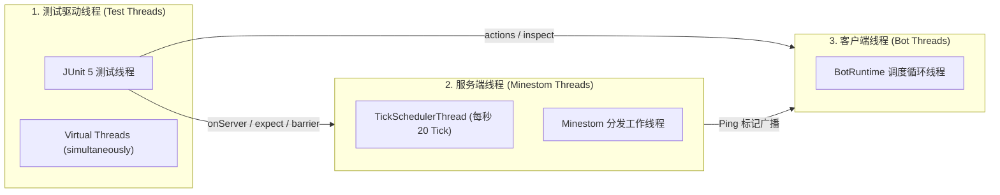
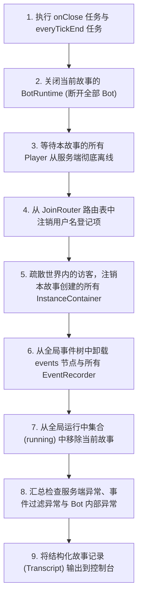

# 线程模型与运行时

[目录](README.md) · 上一篇：[词汇扩展指南](extending-vocabulary.md) · 下一篇：[隔离测试与服务端准备](isolated-and-setup.md)

本篇目录：

- [三类线程域与线程隔离](#三类线程域与线程隔离)
- [服务端线程调用禁忌与守卫（Guard）](#服务端线程调用禁忌与守卫guard)
- [在服务端线程上安全执行（`onServer`）](#在服务端线程上安全执行onserver)
- [故事内并发分支（`simultaneously`）](#故事内并发分支simultaneously)
- [事件监听与记录（Events）](#事件监听与记录events)
- [服务端后台异常捕获与追踪机制](#服务端后台异常捕获与追踪机制)
- [故事清理流程（Teardown 9 步规范）](#故事清理流程teardown-9-步规范)

---

## 三类线程域与线程隔离

在 `story` 测试运行过程中，同时存在三组不同职责的线程：



1. **测试驱动线程（Test Threads）**：
   JUnit 5 分配给测试用例的线程，以及 `simultaneously` 动态生成的虚拟线程（Virtual Threads）。负责驱动故事 DSL 代码向前推进。**允许调用所有阻塞与等待方法**。
2. **服务端线程（Minestom Threads）**：
   以 `TickSchedulerThread` 为核心的服务端内部线程。负责推进世界 Tick、碰撞计算与数据包广播。**绝对禁止阻塞等待**。
3. **客户端调度线程（Bot Threads）**：
   每个故事拥有的独立 `BotRuntime` 调度循环线程。负责解析入站网络包、计算本地移动、维护本地世界模型并分发 Observer 回调。

---

## 服务端线程调用禁忌与守卫（Guard）

### 铁律：禁止在服务端线程上调用阻塞方法

Minestom 的服务线程一旦被 `Thread.sleep` 或 `CompletableFuture.get()` 阻塞，**整个服务端的 Tick 循环将彻底冻结**。而所有 Bot 动作与断言均依赖服务端的 Tick 推进来产生数据包和完成网络交互，因此在服务端线程上等待会导致**永久性死锁**。

### 框架守卫检查（`requireNotServerThread`）

所有会引发等待的框架方法（包括 `onServer`、`awaitServer`、`awaitTicks`、`barrier`、`join`、`rejoin`、`expectEvent`、`createInstance` 以及所有的动作与期望），在入口处均会执行守卫检查：

```kotlin
fun requireNotServerThread() {
    check(Thread.currentThread() !is MinestomThread) {
        "不能在 Minestom 的服务端线程上调用会等待的方法：这个线程会等待一个被自己阻塞的 tick"
    }
}
```
一旦误在 `onServer { ... }` 内部或同步事件监听器中调用了动作或断言，框架会立即抛出 `IllegalStateException` 并给出清晰指引。

---

## 在服务端线程上安全执行（`onServer`）

当需要直接修改服务端内部状态或读取服务端的实体对象时，必须通过 `onServer` 切换到服务端调度线程执行：

```kotlin
story {
    // onServer 把代码推送到下一个 tick 开始时执行，并在测试线程上等待其完成
    val playerCount = env.onServer {
        world.instance.players.size
    }
}
```

### 周期性 Tick 钩子（`everyTickEnd`）

如果需要在每个 Tick 结束时（广播数据包发出后）执行定期逻辑：

```kotlin
story {
    val handle = env.everyTickEnd { tick ->
        // 在 Tick 调度线程上执行
    }

    // handle 实现了 AutoCloseable，调用 handle.close() 停止，故事结束时也会自动清理
}
```

---

## 故事内并发分支（`simultaneously`）

为了模拟多个玩家同时行动、或者在玩家行动的同时并发修改服务端状态，使用 `simultaneously`：

```kotlin
story {
    val alice = player("alice")
    val bob = player("bob")

    simultaneously(
        { alice.walksTo(spawn.east(5)) },
        { bob.walksTo(spawn.west(5)) },
        { 
            // 分支 3：也可以在后台等待条件触发
            wait(20)
            place(Block.FIRE, at = spawn.north())
        }
    )

    // 所有分支均顺利完成后，测试线程才继续向下执行
}
```

- **底层驱动**：每个分支由专用的平台虚拟线程（`Thread.ofVirtual()`）驱动，资源开销极小。
- **异常捕获与合并**：若其中一个分支抛出异常，框架会等待其他分支停止，以第一个发生的异常为根原因，其余分支的异常通过 Java 的 `addSuppressed` 机制附加在其后。

---

## 事件监听与记录（Events）

每个故事都拥有专属于自己的子事件节点 `env.events`。

### 自动过滤隔离

`env.events` 会自动过滤事件：
- 属于其他故事或被测访客的事件会被严格丢弃。
- 仅接收与本故事涉及的 `Player`、`Instance` 及内部实体相关的事件。

### 1. `expectEvent`：等待指定事件触发

先挂载监听器，再在当前线程执行触发器，直到捕获到符合过滤条件的第一个事件返回：

```kotlin
val chatEvent = env.expectEvent(
    type = PlayerChatEvent::class,
    filter = { it.player === alice.player },
    timeout = 5.seconds
) {
    alice.says("触发事件")
}

chatEvent.rawMessage shouldBe "触发事件"
```

### 2. `recordEvents`：区间事件流录制

```kotlin
val recorder = env.recordEvents(PlayerMoveEvent::class) {
    it.player === alice.player
}

alice.walks(blocks = 3)

recorder.events.shouldNotBeEmpty()
recorder.close() // 停止录制
```

---

## 服务端后台异常捕获与追踪机制

在共享服务端的并发运行环境下，若某个故事的代码在 Minestom 的后台异步任务（例如调度器任务或区块加载）中抛出了未捕获异常，传统测试往往无法感知，或者引发莫名其妙的连环崩盘。

`story` 实现了全生命周期的异常追踪器 **`ServerExceptionLog`**：

1. **全局劫持**：将 Minestom 的全局异常处理器绑定至 `ServerExceptionLog::record`。
2. **发生时上下文关联**：当服务端发生异常时，不仅记录堆栈和线程名，还会**记录下发生这一刻所有处于 `RUNNING` 状态的故事名单**。
3. **心跳检测主动抛出**：在故事测试线程等待任何异步操作时（每 50 毫秒一次的 Wait Pump），都会主动扫描该日志；一旦发现有服务端异常涉及本故事，立即以 `AssertionFailedError` 中断测试并附带异常堆栈。
4. **定位真凶**：如果并发运行了多个测试，报告中会明确打印 `异常发生时运行中的故事：StoryA，StoryB`，帮助排查是哪个用例引发了服务端并发污染。

---

## 故事清理流程（Teardown 9 步规范）

无论故事成功还是失败，在 `afterEach` 阶段均会严格执行**确定性 9 步故障安全清理**（任何一步抛出异常均不会阻止后续步骤，全部错误合并报告）：



该流程确保了即使测试用例在中间发生断言崩溃，所占用的服务端资源、网络连接、事件节点与世界实例都会被 100% 干净释放，绝不污染后续测试用例。

[目录](README.md) · 上一篇：[词汇扩展指南](extending-vocabulary.md) · 下一篇：[隔离测试与服务端准备](isolated-and-setup.md)
