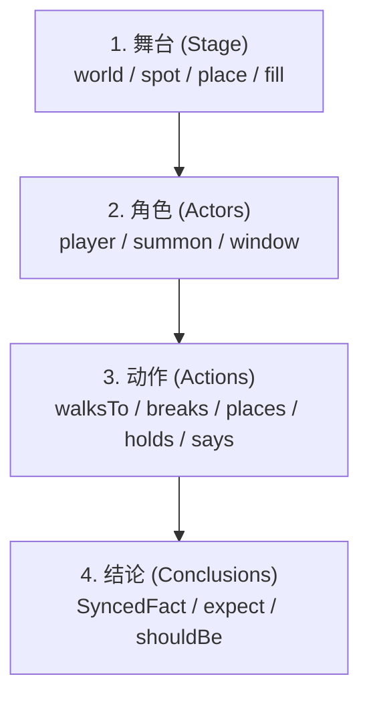
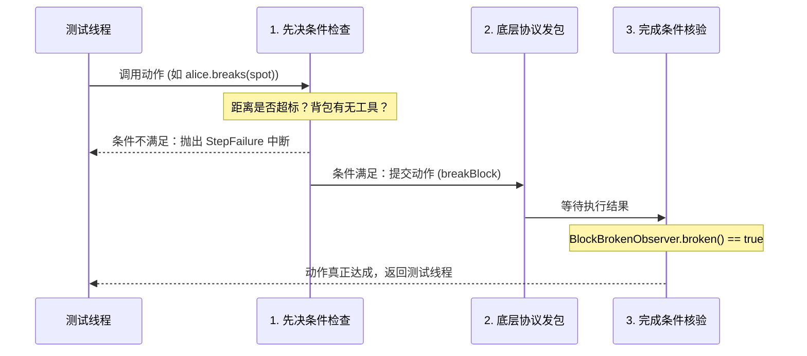

# 核心原语教程：系统化理解故事测试

[目录](README.md) · 下一篇：[快速上手](getting-started.md)

本教程旨在帮助读者建立关于 `story` 测试框架的**系统化心智模型**。我们将拆解框架中的所有核心测试原语，剖析它们背后的设计哲学、执行机制以及组合范式。

---

## 目录

- [一、心智模型：为什么是「故事（Story）」？](#一心智模型为什么是故事story)
- [二、舞台搭建：空间与世界原语（World & Spot）](#二舞台搭建空间与世界原语world--spot)
- [三、角色登场：玩家、实体与观察视角（Actors & View）](#三角色登场玩家实体与观察视角actors--view)
- [四、驱动演进：动作原语与先决条件（Actions）](#四驱动演进动作原语与先决条件actions)
- [五、时间与结构：Tick、等待、并发与预期失败（Time & Structure）](#五时间与结构tick等待并发与预期失败time--structure)
- [六、状态判定：事实、期望与双端同步（Facts & Expectations）](#六状态判定事实期望与双端同步facts--expectations)
- [七、穿透黑盒：服务端执行与事件原语（Server & Events）](#七穿透黑盒服务端执行与事件原语server--events)
- [八、终章实战：串联所有原语的完整故事](#八终章实战串联所有原语的完整故事)

---

## 一、心智模型：为什么是「故事（Story）」？

传统的单体测试通常是静态的：
```
Arrange（准备内存对象） -> Act（调用一个方法） -> Assert（验证返回值）
```

但 Minecraft 特性测试本质上是一个**分布式时序系统测试**：
- 服务端逻辑运行在 Tick 线程上，以 50ms 为周期推进；
- 玩家操作来自逻辑客户端（Bot），通过网络 TCP 数据流异步发包；
- 游戏结果既包含服务端的数据变化，又包含客户端的界面渲染与模型更新。

如果用传统的命令式写法拼凑代码，测试会充斥着底层 Socket 发包、繁琐的线程切换和脆弱的 `Thread.sleep`。

`story` 提出了**测试即故事（Story as Specification）**的心智模型。一个测试就是一个剧本，由四个核心维度构成：



在故事中，每个测试原语都不是孤立的方法，而是代表剧本时序推进的一个**动作节点**。

---

## 二、舞台搭建：空间与世界原语（World & Spot）

编写测试的第一步是定义剧情发生的舞台。

### 1. 世界原语：`world` 与 `WorldActor`

```kotlin
story {
    // 默认世界：在首次使用 spawn 或 world 之前可定制地形
    world {
        layer(Block.BEDROCK, thickness = 1)
        layer(Block.STONE, thickness = 62)
        layer(Block.GRASS_BLOCK, thickness = 1)
        time = 6000L // 游戏时间设为正午
        preload = 2  // 预载周围 5x5 区块
    }
}
```

- **隔离性**：每个故事的世界都是独立的 Minestom `InstanceContainer`。多个并发运行的故事各自生活在独立的空间，坐标再相近也不会碰撞。
- **就绪保证**：`world` 创建时会自动等待中心区块预加载完成（`CompletableFuture.allOf`），绝不会出现「玩家掉入未加载虚空」的问题。

### 2. 坐标原语：`Spot` 与相对空间几何

在自动化测试中，**绝对坐标（如 `(1024, 64, -2048)`）是代码可读性的毒药**。`story` 引入了 `Spot` 作为空间基本原语。

```kotlin
val origin = spawn           // 出生点方块格 (0, 64, 0)
val frontBlock = origin.north(2) // 沿 Z 轴负方向前进 2 格 -> (0, 64, -2)
val elevated = origin.up(1)      // 向上 1 格 -> (0, 65, 0)
```

`Spot` 代表一个**整数方块格**，它提供了三个关键的几何锚点：
- `spot.center: Pos`：方块底面的中心 `(x + 0.5, y.toDouble(), z + 0.5)`，即玩家**稳稳站立**在该方块上的坐标。
- `spot.middle: Vec`：方块三维包围盒的正中心 `(x + 0.5, y + 0.5, z + 0.5)`，用于**射线瞄准、视线对准**。
- `spot.point: Vec`：方块基准原点 `(x, y, z)`，用于底层发包。

### 3. 布景原语：`place` 与 `fill`

```kotlin
// 放置单个方块
val furnaceSpot = place(Block.FURNACE, at = spawn.north(2))

// 区域方块填充
fill(from = spawn.east(1), to = spawn.east(5), block = Block.STONE)
```

> [!NOTE]
> **隐式自动同步**：当你调用 `place` 或 `fill` 时，框架不仅在服务端修改了方块，还会**自动对该世界内的所有在线玩家执行一次同步屏障（Barrier）**。后续代码继续执行时，所有客户端已经确认收到了方块更新。

---

## 三、角色登场：玩家、实体与观察视角（Actors & View）

舞台搭建好后，演员入场。

### 1. 玩家原语：`PlayerActor`

通过 `player("name") { ... }` 声明一个玩家角色：

```kotlin
val alice = player("alice") {
    at = spawn.east(2)                  // 入场坐标
    facing = Direction.NORTH            // 初始面朝北方
    gameMode = GameMode.SURVIVAL        // 生存模式
    hand(Material.DIAMOND_SWORD)        // 手持物品
    inventory(Material.BREAD * 5)       // 背包物资
}
```

#### 双重身份解析
`PlayerActor` 在底层同时持有两组对象：
1. **服务端的权威代表**：`alice.player`（Minestom 的 `Player` 对象）；
2. **逻辑客户端代表**：`alice.bot`（真实的 `Bot` 客户端协议实例）。

当你声明 `alice` 时，框架会在底层建立 TCP 握手、进行配置阶段路由，并等待客户端确认发送 `Player Loaded` 数据包，最后在服务端设置生命值、背包与装备，并执行同步屏障。整个过程全自动完成。

### 2. 玩家自身的身位参照

玩家角色自带动态身位原语，随着玩家移动动态变化：
- `alice.feet: Spot`：玩家双脚当前所处的方块格。
- `alice.below: Spot`：玩家脚下踩着的方块格（`alice.feet.down()`）。
- `alice.front(blocks = 1): Spot`：沿玩家当前面朝的水平方向向前数第 $N$ 格。

```kotlin
// 挖掘脚下的方块：无需计算具体坐标，直观表达业务意图
alice.breaks(alice.below)
```

### 3. 实体原语：`EntityActor`

除了玩家，世界中还可以召唤非玩家实体：

```kotlin
val zombie = summon(EntityType.ZOMBIE, at = spawn.north(3)) {
    health = 10.0f
    customName = Component.text("守卫僵尸")
}
```

---

## 四、驱动演进：动作原语与先决条件（Actions）

剧本的核心是动作。`vanilla` 提供了原版玩家动作库，所有动作均体现为 `PlayerActor` 的扩展方法。

### 动作的三段式法则

每个动作原语都不是简单地触发一个异步事件，而是遵循严格的**三段式确定性流程**：



### 常用动作原语一览

#### 移动与朝向
- `alice.walksTo(spot)`：通过 A* 寻路走到目标方块格。
- `alice.walks(blocks)`：沿当前朝向笔直向前移动。
- `alice.jumpsTo(spot)`：跳跃上高一格的方块台阶。
- `alice.looksAt(spot)` / `alice.looksAt(entity)`：转头看向目标。

#### 方块交互与交互距离约束
- `alice.breaks(spot)`：破坏方块。自动遵循手持工具硬度计算时间，等待方块破碎确认。
- `alice.places(material, against, face)`：放置方块。自动将物品换至主手，右键对准接触面放置。
- `alice.uses(spot)`：右键使用方块（如拉动拉杆、按下按钮）。

> [!IMPORTANT]
> **真实交互距离（Reach）**：如果目标方块距离眼睛超过 $4.5$ 格，或者实体超过 $3.0$ 格，动作会立即失败并报错：
> `world (0, 64, 10) 不在 alice 的交互距离之内：眼睛到方块的距离为 10.00，上限为 4.50；先让 alice 走近`。
> 杜绝测试写出违背 Minecraft 物理法则的「超距离交互」。

#### 物品与背包
- `alice.holds(material)`：将指定物品拿在主手。如果物品在背包槽位中，会自动发包将其与快捷栏槽位交换。
- `alice.eats(material)`：自动计算食物的食用耗时并按住右键，直到吃完。
- `alice.drops(material, all = false)`：将主手中的物品丢弃到地面。
- `alice.swapsHands()`：按下 F 键交换主副手。

#### 社交与指令
- `alice.says("你好")`：发送公开聊天。
- `alice.runs("time set day")`：执行指令。

---

## 五、时间与结构：Tick、等待、并发与预期失败（Time & Structure）

### 1. 时间原语：物理 Tick vs 故事时钟

在 `story` 中，严禁使用 `Thread.sleep`。框架提供了两种严密的时间原语：

```kotlin
// 等待游戏内部时钟走过 20 个 Tick (整整 1 秒的游戏物理时间)
wait(20)

// 等待故事挂钟走过 2 秒时长
wait(2.seconds)
```

- **`wait(ticks: Int)`**：依附于 Minestom 内部调度器，精确数出 $N$ 次 Tick 循环。适合表达熔炉烧炼、药水持续时间、农作物生长等游戏机制。
- **`wait(duration: Duration)`**：依附于故事时钟（`StoryClock`），如果在调试时断点暂停了服务端，故事时钟也会冻结，不会错误超时。

### 2. 叙述原语：`"..." { }` 与 `step`

使用字符串调用可以为代码段打上业务标签：

```kotlin
"第一幕：收集资源" {
    alice.breaks(treeSpot)
}

"第二幕：工具制作" {
    alice.places(Material.CRAFTING_TABLE, against = spawn)
}
```

测试执行时，控制台与转储报告会以清晰的层级树状图打印这些叙述步骤，耗时一目了然。

### 3. 并发原语：`simultaneously`

测试多个玩家协同或竞争时，使用 `simultaneously`：

```kotlin
simultaneously(
    { alice.walksTo(spawn.east(5)) },
    { bob.walksTo(spawn.west(5)) },
    { 
        // 甚至可以在后台并发修改世界
        wait(10)
        place(Block.TNT, at = spawn)
    }
)
```
底层由轻量级平台虚拟线程驱动，所有分支并行推进。若其中一个分支崩溃，框架会等待其他分支停止并将所有异常通过 `addSuppressed` 聚合上报。

### 4. 预期失败原语：`attempt`

如何验证「生存模式玩家无法破坏基岩」？

```kotlin
val bedrock = place(Block.BEDROCK, at = spawn.north())
val alice = player("alice")

// 尝试执行一个必然会失败的操作
val outcome = attempt {
    alice.breaks(bedrock)
}

// outcome 是一个普通对象，使用 Kotest 断言立即检验
outcome.failed shouldBe true
bedrock.block shouldBe Block.BEDROCK
```
`attempt` 会捕获 `StepFailure`，在步骤记录中将其标记为「✔ 预期之内的失败」，绝不会误将正常的负向测试判为用例崩溃。

基岩的挖掘进度始终为 0，`breaks` 要等满 `defaults.timeout`（默认 10 秒）才失败。失败时 bot 的挖掘已经取消，`attempt` 之后 alice 的其它动作照常执行。

---

## 六、状态判定：事实、期望与双端同步（Facts & Expectations）

动作执行完毕后，如何断言结果？

### 1. 事实原语（Fact）：惰性求值与双端视角

`Fact<T>` 是对游戏内状态的描述。它分为三类：

| 事实类型 | 运行环境 | 典型属性 | 适用场景 |
|---|---|---|---|
| **`ServerFact`** | 服务端 Tick 调度线程 | `world.time`<br/>`zombie.alive`<br/>`alice.online` | 仅服务端内部权威掌握的数据 |
| **`ClientFact`** | Bot 客户端调度线程 | `alice.client.window`<br/>`alice.client.actionBar`<br/>`alice.messages` | 仅客户端本地渲染与展示的内容 |
| **`SyncedFact`** | **双端同时核验** | `spot.block`<br/>`alice.position`<br/>`alice.health`<br/>`alice.hand`<br/>`alice.inventory` | **核心玩法状态**：服务端改了，客户端也必须收到并解析正确！ |

> [!TIP]
> **为什么要双端同步（SyncedFact）？**
> 很多 Bug 的根源是：服务端的变量修改了，但遗漏了发包逻辑，导致玩家客户端画面卡住。`SyncedFact` 会在服务端读取一次，再等待标记到达客户端后在 Bot 模型中读取一次，双端完全匹配断言才算通过！

### 2. 期望原语：`should` 与中缀匹配

在 `story` 中，断言操作符被重载为处理 `Fact` 的中缀表达式：

```kotlin
// 方块类型匹配
spot.block shouldBe Block.STONE

// 空间位置匹配（是否在方块格中）
alice.position shouldBeAt spawn.north(2)

// 物品栏包含匹配
alice.inventory shouldContain Material.DIAMOND
alice.inventory shouldContain (Material.IRON_INGOT * 5)

// 配合 Kotest Matcher
alice.health should beGreaterThan(10.0f)
```

### 3. 原子复合断言：`expect`

当需要多个条件在**同一个 Tick 内同时满足**时：

```kotlin
expect(within = 5.seconds) {
    alice.position shouldBeAt targetSpot
    alice.hand shouldBe Material.BOW * 1
    alice.inventory shouldContain Material.ARROW
}
```
框架会在每个 Tick 结束时进行快照采样，只有某一 Tick 发现全部条件同时为真，断言才判定成功并放行。若超时未满足，输出末次 Tick 采样的全部双端字段。

---

## 七、穿透黑盒：服务端执行与事件原语（Server & Events）

在编写高级业务词汇时，往往需要绕过客户端直接操作服务端底层。

### 1. 服务端直连原语：`server` 与 `onServer`

```kotlin
val playerCount = server("查询在线玩家数") {
    // 这里的代码切换到 Minestom 服务端 Tick 调度线程上安全执行
    world.instance.players.size
}
```

> [!CAUTION]
> **严禁在 `server` 代码块内调用阻塞方法**：
> `server { ... }` 运行在 Minestom 的 Tick 线程上。如果在里面调用了 `alice.walksTo(...)` 或 `expect(...)`，服务端线程就会等待自己被阻塞的 Tick，导致死锁。框架内置了 `requireNotServerThread()` 保护机制，违规调用会立即抛出异常。

### 2. 事件捕获原语：`expectEvent` 与 `recordEvents`

```kotlin
// 等待特定事件发生并获取事件对象
val chatEvent = env.expectEvent(
    type = PlayerChatEvent::class,
    filter = { it.player === alice.player },
    timeout = 3.seconds
) {
    alice.says("触发事件")
}

chatEvent.rawMessage shouldBe "触发事件"
```

每个故事都拥有独立的事件子节点（`env.events`），其他故事并发产生的事件会被自动丢弃，绝不会串包。

---

## 八、终章实战：串联所有原语的完整故事

下面是一个综合了上述所有原语的完整用例——**「双人夺旗竞技场拔旗测试」**：

```kotlin
package io.ib67.yuanban.example

import io.ib67.yuanban.story.Story
import io.ib67.yuanban.story.story
import io.ib67.yuanban.story.vanilla.*
import net.minestom.server.instance.block.Block
import net.minestom.server.item.Material
import kotlin.time.Duration.Companion.seconds

class CaptureTheFlagStories {

    @Story
    fun `红队玩家成功拔出蓝队旗帜并被全场通报`() = story {
        // 1. 舞台搭建
        val flagSpot = place(Block.BLUE_BANNER, at = spawn.north(10))

        // 2. 角色准备
        val redRunner = player("red_runner") {
            at = spawn
        }
        val blueDefender = player("blue_guard") {
            at = spawn.north(8)
            hand(Material.IRON_SWORD)
        }

        "防守方拦截，但红队避开攻击并夺旗" {
            // 3. 并发演进：红队冲刺夺旗，蓝队尝试拦截
            simultaneously(
                {
                    redRunner.walksTo(flagSpot.south(1))
                    // 4. 动作交互：破坏旗帜（拔旗）
                    redRunner.breaks(flagSpot)
                },
                {
                    // 蓝队反应稍慢，20 tick 后转向红队
                    wait(20)
                    blueDefender.looksAt(redRunner.feet)
                }
            )
        }

        "拔旗结果判定" {
            // 5. 复合状态期望：同一个 tick 内旗帜变为空气，且红队背包入账蓝旗
            expect(within = 5.seconds) {
                flagSpot.block shouldBe Block.AIR
                redRunner.inventory shouldContain Material.BLUE_BANNER
            }

            // 6. 客户端事实断言：防守方客户端视野内收到系统广播
            blueDefender.messages shouldContain "蓝队旗帜已被夺取！"
        }
    }
}
```

### 总结对照卡片

| 需求场景 | 推荐测试原语 |
|---|---|
| 我想描述一个方块坐标 | 使用 `Spot`（如 `spawn.north(2)`、`alice.below`） |
| 我想让玩家做某事 | 使用 `alice.<动作>`（如 `walksTo`、`breaks`、`places`、`holds`） |
| 我想两个玩家同时行动 | 使用 `simultaneously { ... }` |
| 我想测试一个违规/禁止的行为 | 使用 `attempt { ... }` 并断言 `outcome.failed == true` |
| 我想等待游戏内部逻辑生效 | 使用 `wait(ticks)`（精确 Tick 等待） |
| 我想验证世界或玩家状态 | 优先使用 `SyncedFact`（如 `spot.block shouldBe ...`） |
| 我想多个条件同时成立才算过 | 使用 `expect(within) { ... }` |
| 我想断言整个过程中状态绝不改变 | 使用 `expectThroughout(ticks) { ... }` |

[目录](README.md) · 下一篇：[快速上手](getting-started.md)
